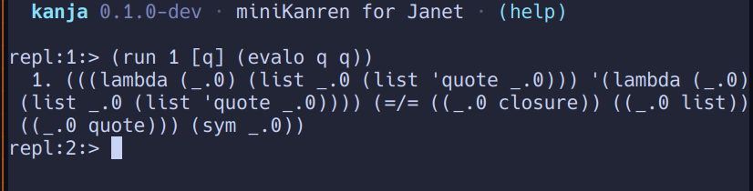

# kanja

> Русская версия: [README.ru.md](README.ru.md)

**miniKanren for Janet.** Relational programming: write a rule once, ask it in
any direction.

```janet
(import kanja :prefix "")
(import kanja/relations :prefix "")

(run* [q] (appendo (llist 1 2) (llist 3 4) q))   # => ((1 2 3 4))
(run* [q] (appendo (llist 1 2) q (llist 1 2 3 4)))  # => ((3 4))
(run* [x y] (appendo x y (llist 1 2 3)))
# => (() (1 2 3))  ((1) (2 3))  ((1 2) (3))  ((1 2 3) ())
```

Three questions, one definition of `appendo`. It was never told which argument
is the input.

## Why this is not a toy

A function knows what goes in and what comes out. A relation does not, and that
buys things functions cannot do:

**Constraints instead of algorithms.** State what must hold; the machine finds
what satisfies it. The same text both checks a solution and finds one.

**Program synthesis.** Write an interpreter as a *relation* between program,
environment and value, and "which program yields this result?" stops being a
separate tool — it is the same interpreter, asked the other way. That is how
miniKanren generates **quines**: not by checking candidates, but by composing
one.



That program was not written by anyone. It was asked for. The constraints
printed beside it are not noise: they are the conditions under which the answer
holds — the name must be a symbol, and it must differ from `list`, `quote` and
`closure`. The machine returned both a solution and the boundary of its own
freedom. Run
`probes/quine-closes.janet` and the generated program is fed forwards through
the same interpreter and compared against itself — the verdict is the exit code.

**Honest partial knowledge.** An unbound variable stays in the answer as a hole:
`(1 _.0 3)` does not mean failure, it means "the second may be anything" — and
surviving demands are printed beside it, because an answer that hides them
claims to know less than it does:

```janet
(run* [q] (symbolo q) (=/= q :a))   # => ((_.0 (=/= (_.0 :a)) (sym _.0)))
```

## Install

```
jpm install https://github.com/arkh-node/janet-kanren
```

Pure Janet: no C, no FFI, no system calls. It runs wherever Janet runs.

```
git clone https://github.com/arkh-node/janet-kanren && cd janet-kanren
./run-tests.sh      # 161 checks, the verdict is the exit code
janet repl.janet    # a REPL with (help) and ten ready examples
```

## What is here

| | |
|---|---|
| core | logic variables · unification with occurs check · complete interleaving search |
| goals | `==` · `=/=` · `fresh` · `conde` · `conj` · `disj` · `succeed` · `fail` |
| demands | `symbolo` · `numbero` · `absento` — deferred, they fire when a later goal decides them |
| asking | `run` · `run*`, over one or several variables |
| resumable search | `search` · `take-more!` · `search-stats` · `search-exhausted?` |
| relations | `caro` · `cdro` · `conso` · `nullo` · `pairo` · `listo` · `membero` · `appendo` · `rembero` |

The core follows **µKanren** (Hemann & Friedman, 2013); the surface follows
**miniKanren** as presented in *The Reasoned Schemer* (Friedman, Byrd,
Kiselyov); the deferred demands follow **cKanren**.

### A search you can put down

A search here is an ordinary value, so you can hold it, stop it and resume it
without recomputing anything:

```janet
(def s (search (fn [q] (evalo q q))))
(take-more! s 1 500)    # => @{:answers @[] :stopped-early true :steps 500}
(take-more! s 1 5000)   # => the quine; 2294 steps spent IN TOTAL, not 5500
```

The budget is a count of stream forcings, and running out of it returns a
partial result with `:stopped-early`, not an exception. Exhaustion is a
*discovery*: having taken six answers out of six, nobody yet knows a seventh
does not exist, so `search-exhausted?` stays false until one more look comes
back empty.

If a relation raises, the error is attached to the search and every later take
returns it again. It is never swallowed and the branch is never skipped —
that would make a broken relation indistinguishable from one with no answers.

## Boundaries

Stated up front, because an unstated boundary is not a boundary but an
undiscovered bug.

🔴 **Lists for relations are built with `(llist 1 2 3)`, not `[1 2 3]`.** A
Janet tuple has a fixed length and cannot express "a list whose tail is not yet
known", so relations carry their own pairs. Hand a relation a native tuple and
it answers *nothing* — and nothing here means "no solutions", which is
indistinguishable from a real answer. Tuples still unify with tuples
element-wise, so ordinary Janet data is fine wherever its shape is fully known.

🔴 **`(quote x)` prints as `'x`.** The canon prints it in full. A deliberate
step towards the reader — the quine carries four `quote`s and nearly doubles in
width without it — confined to printing: the engine, the tests and `to-array`
know nothing about it.

🔴 **Answer order diverges from the canon on a conjunction of two many-valued
`conde`.** We give `(1 8) (1 9) (2 8) (2 9)` where the canon gives
`(1 8) (2 8) (1 9) (2 9)`. Completeness is intact — on an infinite goal the
order matches the canon exactly, and both cases are in the test suite. Found,
localised and not yet explained; the suite records what the engine does today
as a *witness*, not as a reference.

- **Not faster than Prolog.** Complete interleaving search pays for completeness
  with speed. The goal is correctness and clarity, not a record.
- **No CLP(FD)**, no tabling — left recursion is still dangerous.
- **Writing into the substitution is linear in its size**, so a long chain of
  bindings is quadratic overall. Known, measured, and fixable with one change
  (a persistent map); not done yet.
- **Work counters are global**, so `search-stats` reports the sum across
  concurrent searches.
- **No `matche`.** Not written, therefore not promised.
- **Resumability is within a process.** Saving a search to disk and reviving it
  in a new one is a different, much heavier task: closures do not serialise.

## Measured, not asserted

The quine, generated (not verified) on this machine:

| | quine | unifications |
|---|---|---|
| kanja | 143 ms | 1 887 |
| faster-minikanren (Guile) | 22–36 ms | 13 117 |

We perform an order of magnitude fewer unifications at a higher price each: the
bottleneck is the cost of one unification, not the walk.

Constraint output matches the canon term for term. Thirty-eight queries were
run side by side against faster-minikanren under Guile — printed form, answer
order, holes, occurs check, all four kinds of demand — and the only deliberate
difference left is the `'x` shorthand above.

Expectations in the test suite are taken from faster-minikanren run under
Guile, side by side, query for query — not derived from what this engine
happens to print. The suite is also checked by mutation: the engine is broken
in one place at a time and the battery must go red. It catches 14 breakages out
of 15. The fifteenth changes no answer, only cost, and is honestly not covered.

## The name

*kañja* — Sanskrit for lotus, "water-born". Any other reading is yours.

## Lineage

Hewitt, **Planner** (1969) — a goal invokes knowledge by *pattern*, not by name.
Then **Prolog** (Colmerauer, Kowalski, 1972), **Kanren** (Kiselyov),
**miniKanren** (Friedman, Byrd, Kiselyov; MIT Press, 2005), **µKanren**
(Hemann & Friedman, 2013). This library is that line, on Janet.

Nothing substantial here was invented by us. What is ours is the embedding in
Janet and a search you can put down and pick up again.

## License

MIT. The canonical implementations are MIT; this port is legally clean.
